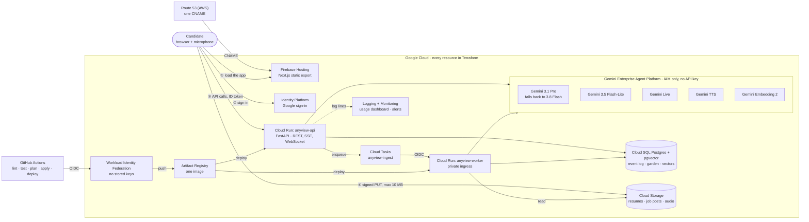

<!-- PROJECT HEADER -->
 

<h3 align="center">AnyView</h3>

  

    Grow your career into a Digital Garden, then practise interviews against it.
     
    <a href="https://anyview.anyapps.cloud"><strong>Open the live app »</strong></a>
    &middot;
    <a href="https://www.youtube.com/watch?v=ePrAzZOZDHw"><strong>Watch the demo »</strong></a>
     
     
    <a href="#a-judges-five-minute-path">Five-minute path</a>
    &middot;
    <a href="docs/demo/demo-scenarios.md">Full demo guide</a>
    &middot;
    <a href="BRIEF.md">Product brief</a>
    &middot;
    <a href="adr/">Decision records</a>
    &middot;
    <a href="docs/setup.md">Run it yourself</a>
  

  

   
   

  

<!-- TABLE OF CONTENTS -->

  
Table of Contents

  <ol>
    <li><a href="#about-the-project">About The Project</a></li>
    <li><a href="#a-judges-five-minute-path">A Judge's Five-Minute Path</a></li>
    <li><a href="#the-digital-garden">The Digital Garden</a></li>
    <li><a href="#practice-against-your-garden">Practice Against Your Garden</a></li>
    <li><a href="#harvey-a-bounded-agent-with-tools">Harvey: A Bounded Agent With Tools</a></li>
    <li><a href="#guardrails">Guardrails</a></li>
    <li><a href="#searching-the-garden-vectors-and-similarity">Searching The Garden: Vectors And Similarity</a></li>
    <li><a href="#how-it-meets-the-challenge">How It Meets The Challenge</a></li>
    <li><a href="#evaluation">Evaluation</a></li>
    <li><a href="#how-its-built">How It's Built</a>
      <ul>
        <li><a href="#architecture">Architecture</a></li>
        <li><a href="#models-and-why">Models And Why</a></li>
        <li><a href="#safeguards-and-operations">Safeguards And Operations</a></li>
        <li><a href="#decisions-we-changed-and-why">Decisions We Changed, And Why</a></li>
        <li><a href="#built-with">Built With</a></li>
      </ul>
    </li>
    <li><a href="#written-with-claude-code">Written With Claude Code</a></li>
    <li><a href="#roadmap">Roadmap</a></li>
    <li><a href="#license">License</a></li>
  </ol>

<!-- ABOUT THE PROJECT -->
## About The Project

What you know about your own career is scattered: an out-of-date CV, a
LinkedIn profile, old performance reviews, notes in a dozen places. When an
interview comes, you rebuild it from memory, under pressure, and the best
examples are the ones you forget.

AnyView gathers that knowledge into a **Digital Garden**: a structured,
connected record of your roles, projects, stories, skills and achievements.
Every entry is backed by a word-for-word quote from what you gave it, and
nothing gets in until you confirm it. You can see the whole garden at once, ask
it questions, and rehearse interviews with an interviewer who has read it. It
is a second brain for your career, but one you tend and can trust, because
every entry shows where it came from.

Two AI personas work in it. **Donna** tends the garden: she reads what you give
her, proposes entries and answers your questions about it. **Harvey** is the
interviewer.

(<a href="#readme-top">back to top</a>)

<!-- FIVE-MINUTE PATH -->
## A Judge's Five-Minute Path

Everything uses one fictional candidate, **Mike Rose**, a cloud solutions
architect. There is no shared test account, on purpose: the repo is public, and a
fresh account lets you walk the whole path yourself.

1. **Sign in.** Open [anyview.anyapps.cloud](https://anyview.anyapps.cloud) and
   sign in with any Google account ([ADR 0041](adr/0041-open-sign-in.md)).
2. **Grow the garden.** In **Digital Garden**, upload
   [`docs/demo/mike-rose-resume.pdf`](docs/demo/mike-rose-resume.pdf). Donna
   reads it in the background and shows each step as it finishes (a few minutes
   for this five-page resume). Open the review queue: every draft quotes the line
   it came from. Press **Confirm all**.
3. **Add what others said.** Upload
   [`docs/demo/mike-rose-feedback.pdf`](docs/demo/mike-rose-feedback.pdf) and
   confirm it. Feedback entries link to the roles and projects they concern.
4. **Look around.** **Explore your experience** has the Graph (try *By role*),
   the competency Coverage heatmap, and **Discover**: ask "What's my best evidence
   for leadership?", then "Have I ever worked with Oracle databases?" to see Donna
   say the garden has nothing on it.
5. **Get interviewed.** In **Practice**, upload
   [`docs/demo/job-description.pdf`](docs/demo/job-description.pdf), choose
   **Panel** and **Interview pace**, and press **Begin** after the microphone
   check. Answer a question or two out loud, stay silent for ten seconds to hear
   Harvey nudge, then switch to typing to finish quickly. The report scores each
   answer on four separate dimensions, with an ideal answer built from the garden.

The [full demo guide](docs/demo/demo-scenarios.md) has strong and weak answers
to try, and the moments worth seeing (the hard stop, barge-in, the close). Each
account can start ten interviews and ten uploads a day.

(<a href="#readme-top">back to top</a>)

<!-- THE DIGITAL GARDEN -->
## The Digital Garden

**Uploading a resume.** Upload a resume (PDF or Word) and Donna reads it as a
background job, so you can keep working while it runs. She first splits it into
sections (each job in your experience is its own section), then reads every
section **in parallel** with Gemini, merges the results, folds near-duplicate
skills ("GCP" and "Google Cloud") and links skills to the roles, projects and
credentials that show them. A progress view shows each step as it finishes, and
a **Cancel** button stops the job without adding anything. A one-page resume
takes about 90 seconds.

Every draft carries the word-for-word quote it was drawn from. A draft whose
quote can't be found in your document is marked unverified, never silently
dropped or accepted. Entries come in eight kinds: roles, projects, stories,
skills, achievements, education, languages and feedback others have given you.

**Capturing.** Beside uploads, a capture box takes either a **Freeform
thought** ("write naturally; Donna will identify the useful entries"), which
goes through the same pipeline, or a **formatted entry**: a form per entry type
(a story asks for situation, task, action and result). Formatted entries skip
the model and join the garden at once.

**Tending.** Proposals wait in a review queue, and **nothing is committed until
you say so**: you can edit any draft before confirming it, or discard it. Only
confirmed entries join the garden. Uploading a newer resume
proposes only what changed. Every change is kept in a history, so the garden
can always be rebuilt from it.

**Exploring it.** The **Explore your experience** panel has four tabs: Graph,
Entries, Coverage and Discover. **Entries** lists everything by type, where you
can edit or retire any entry. The **Graph** is a **constellation**: a graph of how
your work connects, built only from links you have confirmed. It has three
views. *Constellation* lets the connections alone decide where entries sit.
*By role* gives each job its own territory, so a skill used in two roles
settles between them. *By kind* clusters each entry type, so you can see which
skills have projects behind them and which stand alone. A **coverage heatmap**
(the **Coverage** tab) shows which competencies have strong, weak or no
evidence, role by role.

**Asking it.** In **Discover** you ask Donna about your own career, typed or
spoken ("What have I done with Kubernetes?", "Which project best shows
leadership?"). A question asked out loud is answered out loud. Each answer
cites the garden entries it came from, so you can check it.

(<a href="#readme-top">back to top</a>)

<!-- PRACTICE -->
## Practice Against Your Garden

**Starting an interview.** Setup takes three things:

1. **Your resume.** The one you uploaded before stays on file, so there is
   nothing to pick again; replace it whenever you like.
2. **The job.** Upload the posting (PDF or Word), paste a **link** and let the
   API fetch and read the page, or type it in. Company, role and seniority are
   filled in for you. Every posting you practise for is **saved**, so the next
   interview for the same job is one click.
3. **Difficulty and pace.** Difficulty changes what Harvey knows: a
   *Recruiter screen* (Easy) sees only your resume, a *Hiring manager* (Medium)
   also has the job description, and a *Panel* (Hard) has your whole garden.
   Pace is *Interview pace* (every question has a time limit, and Harvey moves
   on when it runs out) or *Take your time* (no clock).

**Spoken, like the real thing.** A short pre-flight checks your microphone and
speakers while Harvey plans the interview. He then asks each question out loud
over Gemini Live, listens, asks up to two follow-ups and keeps time. Each
question has its own time budget. The clock only runs while Harvey is quiet,
and each follow-up adds the time he judges a good answer needs (30 seconds to 5
minutes). He cuts in when you stall or run long. You can switch to typing at
any point.

**A straight report.** Every answer is scored on each rubric dimension
separately, never as one blended number. Each comes with an ideal answer built
only from your own garden. When the garden has nothing to build it from, the
report says so instead of inventing an answer, which shows you exactly what to
add next. **Download** the report as Markdown, or save it as a PDF.

(<a href="#readme-top">back to top</a>)

<!-- AGENT -->
## Harvey: A Bounded Agent With Tools

Harvey works as an agent, but a bounded one: the model decides what to say and
when to dig deeper, and the API decides what it is allowed to do.

* **Plans.** Gemini 3.1 Pro writes five questions for the job and situation,
  each with its own time budget (45–300 seconds).
* **Uses tools on Gemini Live.** Harvey has two tools. `ask_follow_up` asks
  for permission to probe and says how many seconds a good answer needs; the
  API approves at most two per question, holds the time to 30–300 seconds, and
  refuses once the clock has ended the question. `finish_question` closes the
  question when the answer is complete, or when the candidate wants to stop.
* **Looks things up.** At Panel, Harvey reads a one-line index of your garden
  rather than all of it. When a follow-up needs detail, `ask_follow_up` names up
  to three entries, and the API looks them up and hands them back mid-answer.
* **Adapts between questions.** One fast call rewrites his carry-over notes and
  may reword the next question. It has a 6-second deadline; if it is late or
  fails, he asks the question as planned.

**Why not a fully agentic loop?** We considered one, where the model decides
everything every turn. In testing, each model decision added 2–6 seconds to a
spoken turn and made Harvey harder to predict. The bounded version keeps the
judgement calls with the model and the rules (follow-up budget, clock, which
entries exist) in code that can be tested.

(<a href="#readme-top">back to top</a>)

<!-- GUARDRAILS -->
## Guardrails

Harvey and Donna share the same rules, written into their instructions and
checked by tests:

* **English only.** Live transcription is set to English. If something sounds
  like another language, Harvey assumes he misheard and asks again in English;
  he never switches. Planning, scoring and Donna's answers are in English too.
* **Protected topics.** Neither asks about, guesses at or scores on age, race,
  ethnicity, nationality, religion, sex, gender identity, sexual orientation,
  marital or family status, pregnancy, health or disability, political views or
  union membership. That holds when the materials hint at one (a graduation
  year, a gap between dates) and when the candidate brings one up.
* **Staying in role.** Harvey declines anything that isn't the interview in one
  sentence and returns to the question; repeat, rephrase and clarify are the
  only requests he acts on. Donna declines anything that isn't about the garden.
* **The answer is data.** Scoring treats the answer as something to assess,
  never as instructions; asking for a high score is not evidence of anything.
* **Conduct and distress.** Harvey stays professional and answers abuse once,
  calmly. If the candidate says something that suggests real distress, he drops
  the persona, says it's fine to stop, points them to someone they trust or to
  emergency services, and ends the question. Donna follows the same rule.

(<a href="#readme-top">back to top</a>)

<!-- SEARCH -->
## Searching The Garden: Vectors And Similarity

* **Vectors.** Every confirmed project, story, achievement and feedback entry
  gets one 768-dimension vector from Gemini Embedding 2. It is made before the
  change is saved, so the garden and its vectors never disagree.
* **Similarity.** One SQL query in Cloud SQL Postgres with pgvector filters
  first (this user, these entry kinds, live entries only), then ranks what is
  left by cosine distance. No separate vector database.
* **When search is used.** While a garden is small, the whole of it goes into
  the prompt, so nothing can be missed. The report switches to search
  once a garden passes 20,000 characters. Discover still reads the whole
  garden today; searching past the same threshold is next on the roadmap.

(<a href="#readme-top">back to top</a>)

<!-- CHALLENGE FIT -->
## How It Meets The Challenge

The challenge asks for AI that changes how people access knowledge, make
decisions and get everyday work done. AnyView does this for one person's
professional knowledge:

| Challenge direction | In AnyView |
|---|---|
| Document intelligence | Resumes and job descriptions (PDF, Word or a link) become typed, linked entries, each checked against a quote from the source. |
| Knowledge accessibility | Knowledge scattered across documents and memory becomes one garden you can browse, filter and see as a constellation. |
| Intelligent search / research assistant | Discover answers questions about your career, with a citation for every claim; vector search backs the report. |
| AI copilot | Harvey runs a tailored mock interview as a bounded agent, and Donna keeps the garden up to date as you add more. |
| Decision-making | The coverage heatmap and the report show where your evidence is strong and where it is missing. |

**Google Cloud in use:** Gemini models on Gemini Enterprise Agent Platform
(Gemini 3.1 Pro, Gemini 3.5 Flash-Lite, Gemini 3.8 Flash as a fallback, Gemini
Live, Gemini text-to-speech and Gemini Embedding 2), Cloud Run, Cloud Tasks,
Cloud SQL for PostgreSQL with pgvector, Cloud Storage, Identity Platform,
Secret Manager, Cloud Logging and Monitoring, and Firebase Hosting.

(<a href="#readme-top">back to top</a>)

<!-- EVALUATION -->
## Evaluation

Each number below was measured on the real models while building, and the
decision record named in the last column says how.

| What was measured | Result | Record |
|---|---|---|
| Resume extraction recall, on a real resume checked by hand (`scripts/extraction_recall.py`) | All 14 certifications, both roles with 9 responsibilities, 8 projects, and 36 skill links each checked against a quote | [0019](adr/0019-sectioned-extraction-and-evidenced-links.md) |
| Extraction call time, 30 real calls on Gemini 3.1 Pro | p95 79 s, slowest 112 s. A stuck call now gives up after one 120 s try and falls back, so the worst case per call is about 3 minutes, not 8 | [0045](adr/0045-extraction-fails-fast-and-uploads-can-be-cancelled.md) |
| Report time while the preview Pro model throttled (the report's ten parallel calls drew 13 `429` responses in 12 s) | Worst case from over 8 minutes to about 3.5; the fallback answers in 5–10 s at `low` effort, against 53–69 s at `high` | [0039](adr/0039-the-report-fails-fast-and-falls-back.md) |
| Time to first token on the interviewer's prompt | Flash-Lite 0.8–1.2 s, 3.8 Flash 4 s, 3.1 Pro 5.6 s; Flash-Lite's output matched Pro's on these tasks | [0007](adr/0007-gemini-on-vertex.md) |
| A fully agentic interviewer, one model decision per turn | Added 2–6 s to every spoken turn and made Harvey harder to predict, so tools are bounded instead | [0031](adr/0031-harvey-on-gemini-live.md) |
| Cold start of the API on Cloud Run | About 66 s, refusing requests meanwhile (29 in one week), so one instance stays warm | [0023](adr/0023-one-warm-api-instance.md) |

**What the tests hold in place.** 475 backend tests (run against Postgres with
pgvector in CI) and 94 frontend tests run on every pull request, with
`terraform validate` and a plan. Among them: replaying the event log rebuilds
exactly the same garden; a draft whose quote is missing from the document is
flagged, never dropped; every prompt that talks to or judges the candidate
carries the guardrails; a follow-up beyond the budget is refused; and erasing an
account leaves no row in any table.

**Not measured yet.** A golden retrieval set (questions with the stories that
should come back) is on the roadmap, so search quality is not yet a number.

(<a href="#readme-top">back to top</a>)

<!-- HOW IT'S BUILT -->
## How It's Built

* **No API keys anywhere.** Every model is called on Gemini Enterprise Agent
  Platform with IAM, and CI deploys through Workload Identity Federation. There
  is no stored key to leak.
* **Everything is Terraform.** Pull requests get a plan, and a merge to `main`
  applies it and then deploys. Nothing is created by hand in the console.
* **The garden is event-sourced.** Every confirm, edit and retire is appended to
  a log in Cloud SQL Postgres, and the garden is a projection that can be
  rebuilt from it. A test checks that replaying the log gives the same garden.
* **Long work runs off the request path.** Reading a resume takes about 90
  seconds of model calls, so it runs on a private Cloud Run worker behind Cloud
  Tasks while the browser follows its progress.
* **Speech is native.** Harvey's questions and follow-ups run on Gemini Live,
  with Gemini text-to-speech as the fallback. There is no separate speech API.
* **The browser talks to Cloud Run directly.** The site is static files on
  Firebase Hosting; the API streams to the browser over server-sent events and
  a WebSocket, with no proxy in between to buffer them.

The reasoning behind each choice is in [adr/](adr/), 47 records written as each
decision was made.

(<a href="#readme-top">back to top</a>)

### Architecture

The browser talks to Cloud Run directly: Firebase Hosting serves static files
only, because its rewrites buffer streams. The editable version of this diagram
is [docs/architecture.drawio](docs/architecture.drawio) (open it in
[diagrams.net](https://app.diagrams.net/)).

(<a href="#readme-top">back to top</a>)

### Models And Why

| Model | Used for | Why this one |
|---|---|---|
| Gemini 3.1 Pro (preview) | Planning the interview, reading resumes into the garden, scoring, ideal answers | Judgement calls, where depth matters more than speed |
| Gemini 3.5 Flash-Lite | Splitting a resume into sections, Discover, adapting between questions, transcription | 0.8–1.2 s to first token against 5.6 s for Pro, with the same output quality on these tasks |
| Gemini 3.8 Flash | The fallback for the report and for reading resumes, at low effort | 5–10 s at low effort; Pro's preview build sometimes throttles |
| Gemini Live | The spoken interview, with follow-ups | A real conversation, with barge-in and tool calls, instead of turn-by-turn audio |
| Gemini TTS | Harvey's voice on the turn-based fallback; Donna's voice in Discover | Same platform and identity, so no separate speech API |
| Gemini Embedding 2 | One vector per garden entry | Same project, same IAM, same identity as the chat models |

Asking the next question makes no model call at all: it is a fixed lead-in plus
the planned question, word for word. Asked for "one sentence", the fast model
kept repeating the question.

(<a href="#readme-top">back to top</a>)

### Safeguards And Operations

* **Fallbacks.** If Gemini Live fails, the interview carries on turn by turn
  with text-to-speech; if speech fails, it carries on as text. Report calls get
  two 75-second tries on Pro, then one on Gemini 3.8 Flash, so the worst case
  is about 3.5 minutes rather than 8 or more. Resume extraction does the same
  with one 120-second try, so a stuck section costs about 3 minutes, not 8, and
  you can cancel an upload at any time.
* **Error page.** Unknown pages get a custom, branded 404 page with a real 404
  status and a way back to the app. Page
  loads retry for about 75 seconds, which covers deploys and instance
  replacement, and one warm API instance avoids the ~66-second cold start.
* **Monitoring.** The app writes one log line per activity (sign-ups,
  interviews started and completed, Discover questions, garden uploads) and one
  per model call. Log-based metrics feed an "AnyView usage" dashboard in Cloud
  Monitoring, so sign-ups, interviews, Discover questions and model calls show
  as daily charts, and each sign-up sends the owner an email.
* **Privacy.** A [privacy page](https://anyview.anyapps.cloud/privacy) says what
  is collected, why, where it is kept and for how long. Voice recordings are
  deleted after 30 days, and one click on the Account page erases every file
  and every row.
* **Access.** Sign-in is Google only, open to any verified Google account, with
  the Firebase ID token checked on every signed-in request to the API.
* **Daily limits.** Each account can start ten interviews and ten uploads a day
  (UTC), counted in one SQL statement so two requests cannot both take the last
  one. A failed attempt does not count ([ADR 0047](adr/0047-a-daily-limit-per-user.md)).
* **Upload size.** The 10 MB limit is signed into each upload URL, so Cloud
  Storage refuses a bigger file, and the API checks an object's size before it
  reads it.
* **Custom domain.** The `anyapps.cloud` zone lives in AWS Route 53. Terraform
  writes one CNAME, `anyview.anyapps.cloud` to Firebase Hosting, in its own
  small stack so a stale AWS session can never block a GCP deploy. Firebase
  provisions the certificate.
* **Cost.** A budget alert is provisioned in Terraform from day one, and every
  model call records its tokens (in, out, cached and thinking).

(<a href="#readme-top">back to top</a>)

### Decisions We Changed, And Why

| Area | Started with | Now | Why (ADR) |
|---|---|---|---|
| Model | Claude on Gemini Enterprise Agent Platform (the brief) | Gemini 3.1 Pro and 3.5 Flash-Lite | Claude's quota in the project stayed at zero; Gemini had a default quota (0004 → 0007) |
| Fast calls | Pro for every call | Flash-Lite for splitting resumes, Discover and adapting | 0.8–1.2 s to first token against 5.6 s on Pro, same output quality (0007) |
| Interviewer | An agentic loop, considered; text-to-speech turn by turn | Gemini Live with two bounded tools | A model decision every turn added 2–6 s; Live gives real follow-ups, and TTS stays as the fallback (0028, 0031) |
| Retrieval | The whole garden in every prompt | Embeddings and filter-then-similarity SQL | A garden grows without bound; the report searches once it passes 20,000 characters (0017, 0038) |
| Ingestion | Inside the browser's request | Cloud Tasks and a private worker | A resume takes ~90 s; the queue adds retries, and a lease stops duplicate runs (0034) |
| Scaling | Scale to zero | One warm API instance | A cold start took ~66 s, and Cloud Run refused requests meanwhile (0023) |
| Report | Pro only, 120 s × 4 attempts | Pro 75 s × 2, then 3.8 Flash at low effort | The throttled preview Pro made reports take 8+ minutes; the worst case is now ~3.5 (0039) |
| Follow-up time | One fixed clock per question | The clock pauses while Harvey speaks; each follow-up adds the time he asks for (30–300 s) | Two follow-ups inside the planned time cut candidates off, and Harvey's own speech used up their clock (0040, 0043) |
| Extraction | Pro with 120 s × 4 attempts per section | One 120 s try on Pro, then 3.8 Flash; a Cancel button | Of 30 real calls, p95 was 79 s and the slowest 112 s, yet a stuck one could take 8 minutes; the worst case is now ~3 (0045) |
| Access | Email allow-list | Any verified Google account | The app went live; a usage dashboard and a sign-up email keep watch (0041, 0042) |

Ruled out from the start: AWS (0001); Firestore (0002), because confirming a
change must be one transaction over an event log with relational links; and
LangChain or a dedicated vector database (the brief).

(<a href="#readme-top">back to top</a>)

### Built With

* [![Python][Python.id]][Python-url]
* [![FastAPI][FastAPI.id]][FastAPI-url]
* [![Next.js][Next.js]][Next-url]
* [![React][React.js]][React-url]
* [![TypeScript][TypeScript.id]][TypeScript-url]
* [![Tailwind CSS][Tailwind.id]][Tailwind-url]
* [![PostgreSQL][PostgreSQL.id]][PostgreSQL-url]
* [![Google Cloud][GCP.id]][GCP-url]
* [![Gemini][Gemini.id]][Gemini-url]
* [![Firebase][Firebase.id]][Firebase-url]
* [![Terraform][Terraform.id]][Terraform-url]
* [![GitHub Actions][Actions.id]][Actions-url]

(<a href="#readme-top">back to top</a>)

<!-- CLAUDE CODE -->
## Written With Claude Code

The code in this repository was written by Claude, using
[Claude Code](https://claude.com/claude-code). The owner, a cloud solutions
architect, set the product and the architecture, made the calls recorded in
[adr/](adr/); Claude wrote the code,
the tests and the Terraform to match. [CLAUDE.md](CLAUDE.md) is the working
brief Claude reads at the start of every session: the decided stack, the
conventions and the gotchas learned along the way. Commits Claude made carry a
`Co-Authored-By: Claude` line.

(<a href="#readme-top">back to top</a>)

<!-- ROADMAP -->
## Roadmap

The build follows six phases from the [brief](BRIEF.md#build-order). Spoken
interviews on Gemini Live, with follow-ups, arrived ahead of schedule.

- [x] **Phase 0: mock interview MVP.** One page, five tailored questions asked
  one at a time, a streamed interviewer, a per-dimension scored report you can
  download.
- [x] **Phase 1: auth and the Digital Garden.** Sign-in, capture, the review
  queue, the event log, Discover, and ingestion on Cloud Tasks.
- [ ] **Phase 2: retrieval (in progress).** Done: embeddings, hybrid search,
  and search for the report. Left: Discover's search past its threshold, and a
  golden retrieval test set (question → expected story pairs run as a test).
- [ ] **Phase 3: formats and probing (partly done).** Done: follow-ups on Live,
  adaptive planning and conversation guardrails. Left: HR versus technical formats with per-question
  rubrics, and one click from a gap in the report to a new garden entry.
- [ ] **Phase 4: history and cost (partly done).** Done: the usage dashboard
  and sign-up alerts. Left: session history, trends and cost per interview.
- [ ] **Phase 5: voice (mostly done).** Done: spoken interviews, spoken
  Discover questions and read-aloud answers. Left: voice brain dumps, and
  replaying your own recorded answers.

(<a href="#readme-top">back to top</a>)

<!-- LICENSE -->
## License

Copyright © 2026 AnyApps. All rights reserved. The source is public for the
hackathon's judging only; it may not be used, copied, modified or distributed
without permission. See [LICENSE](LICENSE), and contact
[anyview@anyapps.cloud](mailto:anyview@anyapps.cloud) for permission.

(<a href="#readme-top">back to top</a>)

<!-- MARKDOWN LINKS & IMAGES -->
[Python.id]: https://img.shields.io/badge/Python_3.12-3776AB?style=for-the-badge&logo=python&logoColor=white
[Python-url]: https://www.python.org/
[FastAPI.id]: https://img.shields.io/badge/FastAPI-009688?style=for-the-badge&logo=fastapi&logoColor=white
[FastAPI-url]: https://fastapi.tiangolo.com/
[Next.js]: https://img.shields.io/badge/next.js-000000?style=for-the-badge&logo=nextdotjs&logoColor=white
[Next-url]: https://nextjs.org/
[React.js]: https://img.shields.io/badge/React-20232A?style=for-the-badge&logo=react&logoColor=61DAFB
[React-url]: https://react.dev/
[TypeScript.id]: https://img.shields.io/badge/TypeScript-3178C6?style=for-the-badge&logo=typescript&logoColor=white
[TypeScript-url]: https://www.typescriptlang.org/
[Tailwind.id]: https://img.shields.io/badge/Tailwind_CSS-06B6D4?style=for-the-badge&logo=tailwindcss&logoColor=white
[Tailwind-url]: https://tailwindcss.com/
[PostgreSQL.id]: https://img.shields.io/badge/PostgreSQL-4169E1?style=for-the-badge&logo=postgresql&logoColor=white
[PostgreSQL-url]: https://www.postgresql.org/
[GCP.id]: https://img.shields.io/badge/Google_Cloud-4285F4?style=for-the-badge&logo=googlecloud&logoColor=white
[GCP-url]: https://cloud.google.com/
[Gemini.id]: https://img.shields.io/badge/Gemini-8E75B2?style=for-the-badge&logo=googlegemini&logoColor=white
[Gemini-url]: https://docs.cloud.google.com/gemini-enterprise-agent-platform
[Firebase.id]: https://img.shields.io/badge/Firebase_Hosting-DD2C00?style=for-the-badge&logo=firebase&logoColor=white
[Firebase-url]: https://firebase.google.com/docs/hosting
[Terraform.id]: https://img.shields.io/badge/Terraform-7B42BC?style=for-the-badge&logo=terraform&logoColor=white
[Terraform-url]: https://www.terraform.io/
[Actions.id]: https://img.shields.io/badge/GitHub_Actions-2088FF?style=for-the-badge&logo=githubactions&logoColor=white
[Actions-url]: https://github.com/features/actions
